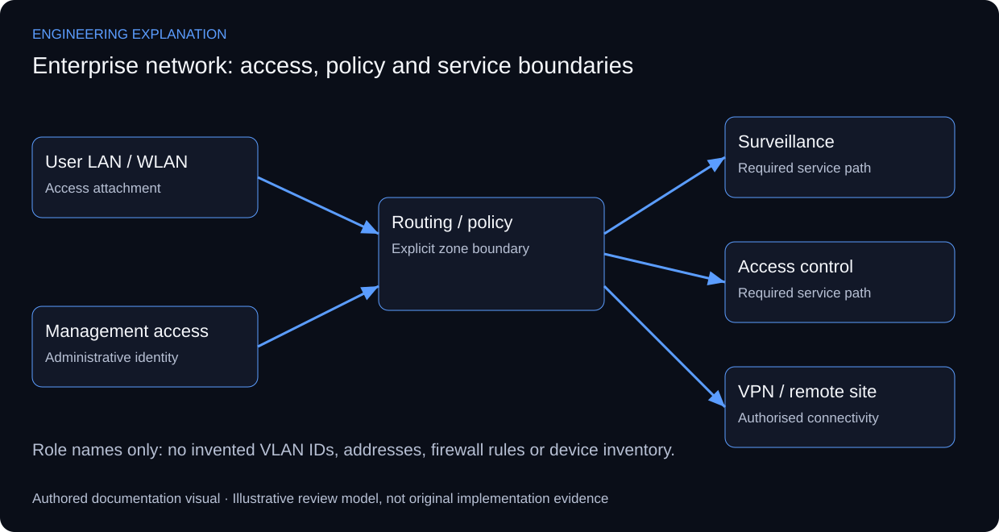

# Enterprise Wireless & Network Infrastructure Architecture

## Separating user access, site services and management

The documented infrastructure uses MikroTik and Ubiquiti for multi-zone LAN/wireless access, routing, VPN connectivity and traffic management, with surveillance and access-control integration. The original source architecture is retained. Its functional relationships do not establish an unpublished device inventory, address plan or configuration export.

A readable architecture separates access attachment from routing policy and service integration. User, surveillance, access-control and management traffic have different destinations and administrative needs. Segmentation is explained here as a design responsibility; the exact VLAN IDs, firewall rules and VPN type must come from actual configurations rather than being inferred from a source poster.

The reference boundary matrix asks which traffic is intended to cross each boundary, why it is allowed and how that permission is checked. A permitted client-to-service connection does not establish unrestricted inter-zone access. Similarly, VPN reachability is different from local WLAN coverage. Cisco’s campus reference supports layered access/routing reasoning; it is not evidence that Cisco hardware or SD-Access was deployed in this project.

Validation should pair positive tests with negative policy tests and include management access. A reusable documentation record identifies source zone, destination service, expected policy and observed result. Public examples use role names rather than customer subnets. Original addressing, authentication settings and acceptance outputs remain unavailable in the public release.

*New explanatory responsibilities and review criteria; not an as-built drawing or new test result.*

## Review scenarios and expected evidence

These are review criteria, not additional completed tests.

| Review area | Method | Evidence to inspect |
|---|---|---|
| User to required service | Check intended source/destination policy | Permitted function with its recorded context |
| Unrelated zones | Attempt a disallowed reference flow | Isolation verified separately from routing |
| Device administration | Review management path and identity | Access limited according to the actual policy |
| Remote site | Check VPN path independently from WLAN | Tunnel/routing evidence and service test |

## Primary technical references

- [Cisco — Enterprise Campus Architecture](https://www.cisco.com/c/en/us/td/docs/solutions/Enterprise/Campus/campover.html)

References support the explanation, not undocumented implementation claims.

The boundary matrix is explanatory. No illustrative address plan or configuration is passed off as an as-built network export.

[Published case study](https://mahyoub88.github.io/projects/proj-enterprise-network/).
