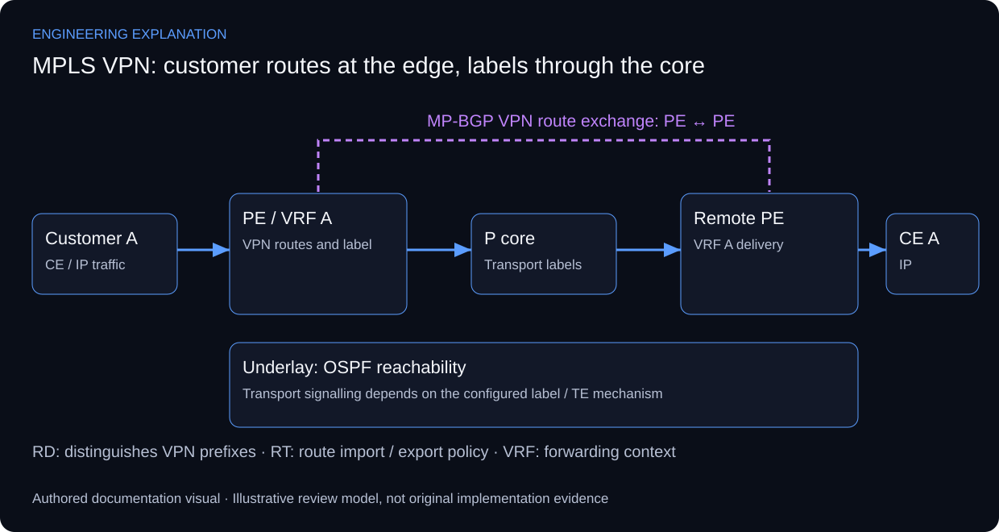

# Network Infrastructure Design — MPLS Backbone

## Understanding the underlay, VPN control plane and label path

The source documents a Cisco 7200 backbone built and validated in GNS3 using OSPF, MPLS traffic engineering, VRFs and MP-BGP. The original topology preview is preserved as the implementation environment. This is distinct from the enterprise/wireless projects; the backbone explanation should not imply that their equipment participates in the same network.

OSPF supplies reachability to backbone destinations. Label forwarding transports traffic through the provider core. PE routers maintain the customer VRFs and exchange VPN routes with MP-BGP; P routers provide core transport and need not carry the customer VPN routing tables. The diagram deliberately keeps the VPN control-plane responsibility at the PEs.

RFC 4364 separates the route distinguisher, which makes VPN routes distinct, from route targets, which influence import/export policy. A reference example with two isolated customer contexts can explain overlapping prefixes without claiming those exact customers or addresses existed in the source topology. RFC 3031 supports the distinction between label distribution/control and actual packet forwarding.

Verification should progress from underlay to transport labels, VPN route exchange and customer forwarding. Useful read-only IOS checks include show ip ospf neighbor, show mpls forwarding-table, show ip vrf and show ip bgp vpnv4 all; command support varies by image. LDP checks apply only when LDP is configured. A traffic-engineering path needs its own tunnel/signalling context and cannot be proved by an LDP neighbour table alone.

*New explanatory responsibilities and review criteria; not an as-built drawing or new test result.*

## Review scenarios and expected evidence

These are review criteria, not additional completed tests.

| Review area | Method | Evidence to inspect |
|---|---|---|
| Underlay | Inspect OSPF adjacency and PE reachability | Reachable VPN next hop |
| Label transport | Inspect forwarding entries and applicable signalling | Label path to the remote PE |
| VPN routes | Inspect VPNv4 routes and RT policy | Intended routes imported into the intended VRF |
| Customer forwarding | Test same-VPN and disallowed cross-VPN paths | Reachability and isolation checked independently |

## Primary technical references

- [BGP/MPLS IP VPNs — RFC 4364](https://www.rfc-editor.org/rfc/rfc4364)
- [MPLS architecture — RFC 3031](https://www.rfc-editor.org/rfc/rfc3031)

References support the explanation, not undocumented implementation claims.

Command names are a verification guide. No console outputs, configuration exports, router identifiers or acceptance results have been invented.

[Published case study](https://mahyoub88.github.io/projects/proj-mpls-backbone/).
