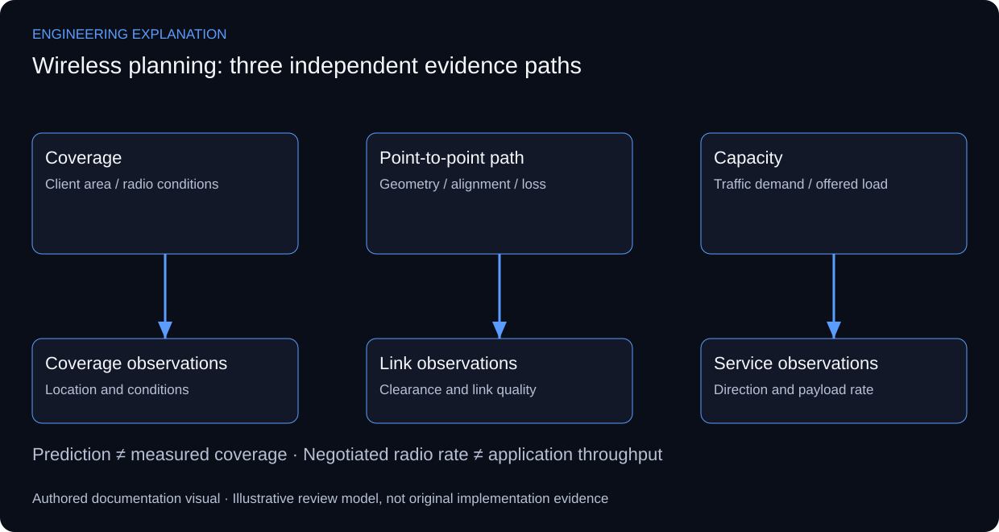

# Wireless Coverage & Point-to-Point Network Planning

## Coverage, backhaul and capacity answer different questions

The implementation covers wireless coverage modelling and point-to-point connectivity, including antenna alignment, capacity and site coverage. The original planning media are preserved. A colour coverage view communicates spatial planning but does not, by itself, provide measured signal strength or a complete capacity test.

Coverage asks where a client can maintain the required radio service. Backhaul asks whether the path between fixed endpoints has adequate propagation and clearance. Capacity asks whether the radio and network can deliver the required traffic under the defined load. Treating these as separate review paths keeps a nominally covered area from being presented as guaranteed throughput.

A planning record needs the radio settings, antenna pattern, installation geometry and environmental assumptions associated with its prediction. Field validation then associates locations and conditions with measurements. ITU-R P.530 supplies point-to-point propagation context, while a site-specific WLAN plan also needs the selected equipment and client conditions. No frequencies or sector counts are reconstructed from the low-resolution preview.

Alignment should be reviewed against the intended endpoint and polarisation before optimising observed signal. Capacity validation should distinguish radio link quality, negotiated rate and application throughput, and state direction and offered load. The diagram below is an engineering review map, not a newly simulated or surveyed coverage result.

*New explanatory responsibilities and review criteria; not an as-built drawing or new test result.*

## Review scenarios and expected evidence

These are review criteria, not additional completed tests.

| Review area | Method | Evidence to inspect |
|---|---|---|
| Coverage prediction | State radio and geometry assumptions | Model context attached to its coverage view |
| Path alignment | Check endpoint direction and polarisation | Alignment record linked to link quality |
| Capacity | Separate negotiated rate from payload throughput | Direction, load and test duration recorded |
| Field review | Associate observations with locations/conditions | Measured points separated from predictions |

## Primary technical references

- [ITU-R P.530 — terrestrial line-of-sight link design](https://www.itu.int/rec/R-REC-P.530/en)

References support the explanation, not undocumented implementation claims.

No new coverage heatmap, site coordinates or throughput measurement is fabricated. The source planning view remains the available project evidence.

[Published case study](https://mahyoub88.github.io/projects/proj-wireless-coverage/).
